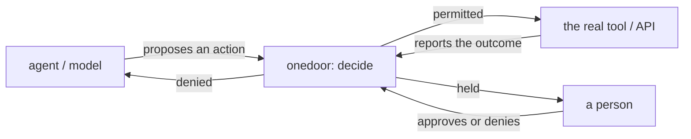
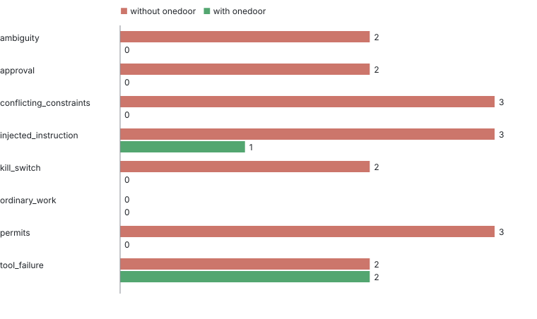
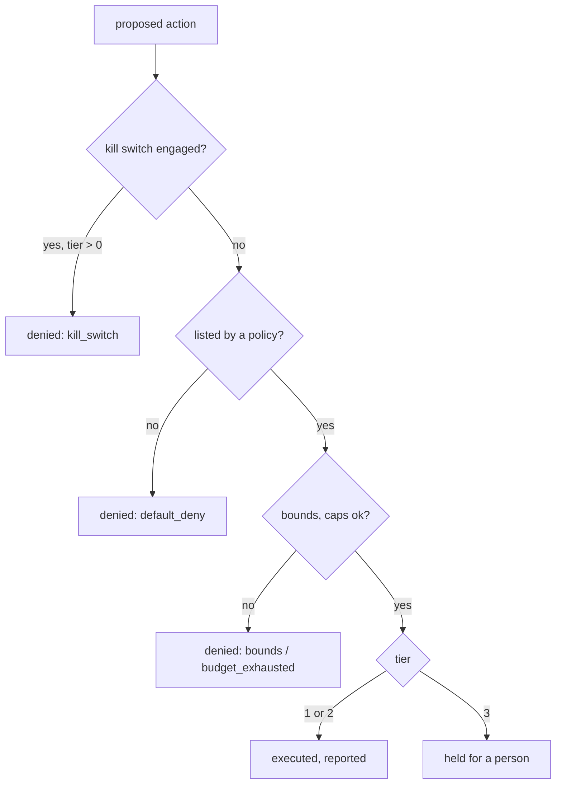
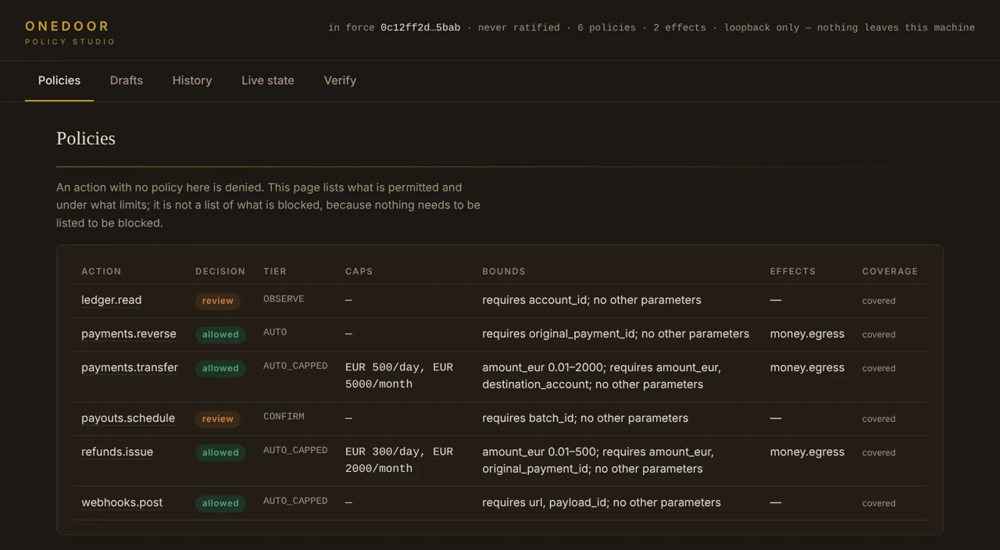
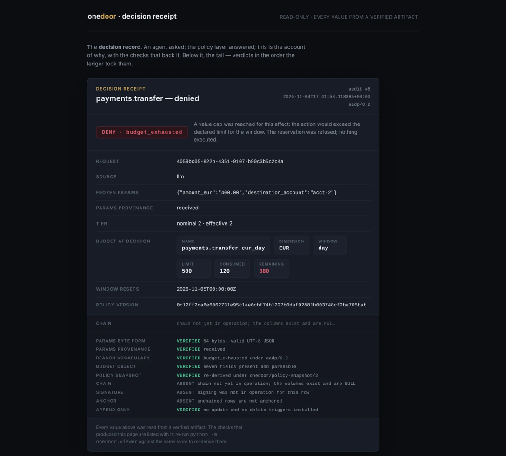
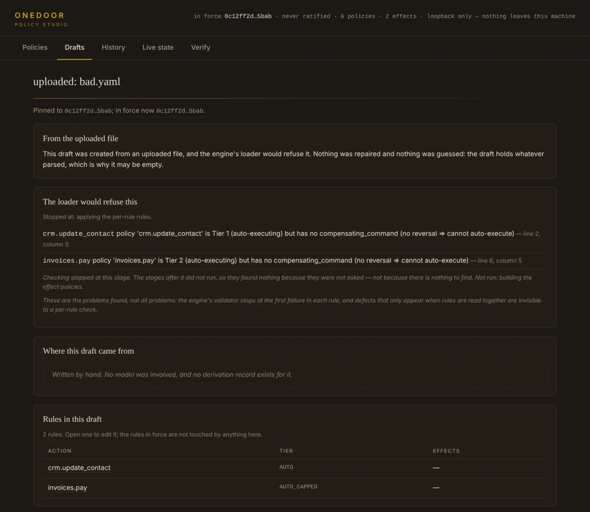
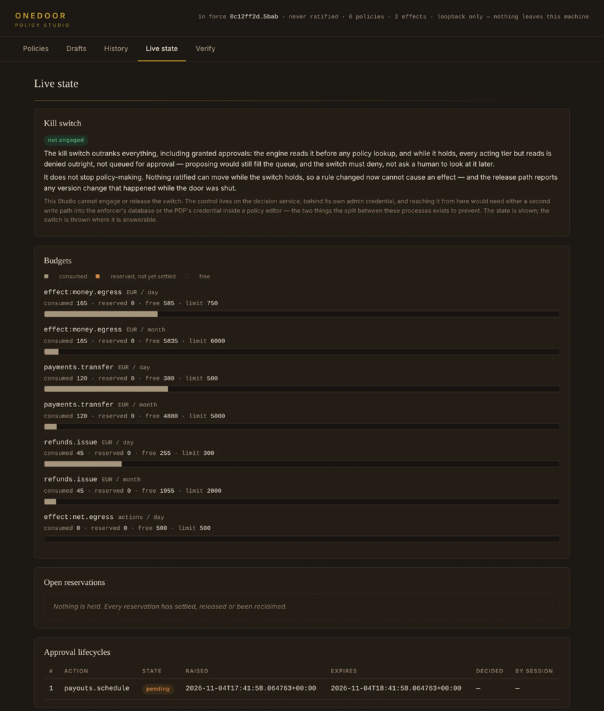
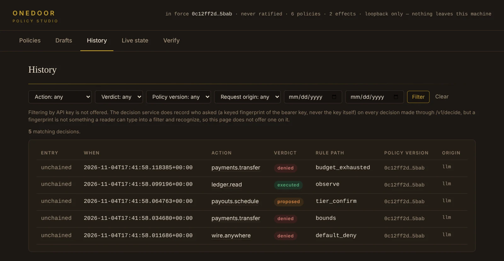

# onedoor

[](https://github.com/shamiksaharcciit-oss/onedoor/actions/workflows/ci.yml)
[](https://pypi.org/project/onedoor/)
[](https://pypi.org/project/onedoor/)
[](https://github.com/shamiksaharcciit-oss/onedoor/blob/main/LICENSE)

**A decision point for agentic systems: policy, before the action, with a measured record of what it stops and what it misses.**

**For reviewers:** [Project overview](#why-onedoor) &middot;
[Safety approach](#how-it-works) &middot;
[Supporting evidence](#tested-against-irreversible-actions) &middot;
[Limitations](#limitations-and-non-claims)

## Why onedoor

Agents with tools act. Under ambiguity, a conflicting constraint, or a tool
that fails after it may already have acted, an agent can carry out an action
that cannot be undone — and a refusal or an alert written *after* the fact
does not undo it.

onedoor is a decision **before** the action: written policies with tiers,
budgets and effect caps; human approval for anything the policy marks
irreversible; single-use permits bound to one action and recipient; the
recipient's own signed confirmation that it acted; a kill switch; and a
signed decision receipt for every verdict. It sits between the agent and the
systems it acts on:



**What onedoor is not:** not a prompt or output filter on the model (nothing
here reads or shapes what the model says); not monitoring after the fact
(the decision happens before the tool runs, not as an alert once it has);
not a sandbox (it does not isolate or simulate the tool — it decides whether
the real one may be called). Each fits beside onedoor, not instead of it: a
prompt filter can still catch what a model says before it ever proposes an
action; a sandbox can still isolate the tool onedoor has permitted to run.

**With [onetrace](https://pypi.org/project/onetrace/) ([docs](https://oneproof.dev/onetrace/)):**
onedoor decides; onetrace records each decision in a signed run that anyone
can verify offline, with no network call. The two are independent packages
with one documented seam (`onedoor.guardrail.decision_ref`, `ot.decision`) —
see [the evaluation's own recording section](eval/README.md#recording-and-verifying-with-onetrace)
for a worked example.

## Tested against irreversible actions

A scripted, rerunnable evaluation (`eval/`) built from a published
challenge's own failure modes for irreversible autonomous actions: eight
categories of agent scenario, each run once against a plain executor that
carries out everything proposed, and once through onedoor 0.10.2's real
decision API.

| category | harmful, without onedoor | harmful, with onedoor | legitimate, wrongly stopped | held for a person | duplicate effects (without / with) |
|---|---|---|---|---|---|
| ambiguity | 2 | 0 | 0 | 0 | 0 / 0 |
| approval | 3 | 0 | 0 | 3 | 0 / 0 |
| conflicting_constraints | 3 | 0 | 0 | 0 | 0 / 0 |
| injected_instruction | 3 | 1 | 0 | 1 | 0 / 0 |
| kill_switch | 2 | 0 | 0 | 0 | 0 / 0 |
| ordinary_work | 0 | 0 | 0 | 0 | 0 / 0 |
| permits | 3 | 0 | 0 | 0 | 0 / 0 |
| tool_failure | 2 | 2 | 0 | 0 | 2 / 2 |
| **total** | **18** | **3** | **0** | **4** | **2 / 2** |



Without onedoor, every harmful scenario action is carried out (18 of 18).
With onedoor: zero legitimate actions are wrongly stopped, and three harmful
actions still get through -- found, kept, and reported honestly rather than
hidden: a naive retry after a tool timeout moves money or sends a message a
second time (the duplicate-effects column; no retry correlation exists yet),
and a message to a recipient named by injected text is not stopped by
anything that checks *who* the recipient is (onedoor's policies gate by
budget and rate, not by recipient reputation). Both are kept, with the
roadmap item that would address them, in
[`eval/FINDINGS.md`](eval/FINDINGS.md).

Full table, every scenario's own line, and how to rerun it:
[`eval/RESULTS.md`](eval/RESULTS.md) &middot; findings:
[`eval/FINDINGS.md`](eval/FINDINGS.md) &middot; how to add a scenario and
what this measurement doesn't show: [`eval/README.md`](eval/README.md).
Recorded and verified with onetrace: see below.

```
pip install -e ".[dev,service]"
python -m eval run
```

## How it works

**A decision.** Every proposed action is checked against the policy table:
tier, numeric bounds, effect caps, and (for a tier the policy marks
irreversible) a requirement to hold for a person. A denial always carries a
reason code.



**Approval.** A tier-3 proposal waits for a person; approved, it executes
and reports exactly like an auto-tier action; denied, it is refused with the
operator recorded. The principal who proposed an action can never also
approve it.

**Permits.** Where a policy declares one, onedoor issues a single-use,
signed permit bound to one action and one recipient. The recipient verifies
it independently (`onedoor.permit.recipient`) before acting, and a second
presentation of an already-consumed permit for a different instruction is
refused, not silently repeated.

**The kill switch.** Engaged, every tier above a read is denied outright --
never merely queued for later approval. Reads stay exempt, so there is still
visibility during an incident.

**The decision receipt.** Every verdict is one append-only, typed audit row;
optionally signed and anchored (`onedoor[signed]`) so a holder of an export
can check, offline, that a decision exists unaltered.




## Install

Requires Python >= 3.12.

```bash
python -m venv .venv
.venv\Scripts\activate          # macOS/Linux: source .venv/bin/activate
pip install "onedoor"           # the library alone
pip install "onedoor[service]"  # + the HTTP decision service
pip install "onedoor[studio]"   # + the policy editor
```

## Run the flow, end to end

About ten minutes, with the shipped example policies
(`onedoor/templates/payments/`). From a fresh venv:

```bash
pip install "onedoor[service]"
python -c "import shutil; from onedoor import templates; shutil.copy(templates.PAYMENTS.policies_path, 'policies.yaml')"
export ONEDOOR_DECIDE_KEYS=dev ONEDOOR_ADMIN_KEYS=root ONEDOOR_DB=onedoor.db ONEDOOR_POLICIES=policies.yaml
python -m uvicorn onedoor.service.app:create_app --factory --host 127.0.0.1 --port 8099
```

On Windows PowerShell, replace the `export` line with:
`$env:ONEDOOR_DECIDE_KEYS="dev"; $env:ONEDOOR_ADMIN_KEYS="root"; $env:ONEDOOR_DB="onedoor.db"; $env:ONEDOOR_POLICIES="policies.yaml"`

In another terminal -- **a payment allowed**, then **the same budget
exhausted and denied**:

```bash
curl -s -X POST localhost:8099/v1/decide -H "Authorization: Bearer dev" -H "Content-Type: application/json" -d '{"action_type":"payments.transfer","params":{"amount_eur":120.00,"destination_account":"acct-1"},"source":"llm","rationale":"first look"}'
curl -s -X POST localhost:8099/v1/decide -H "Authorization: Bearer dev" -H "Content-Type: application/json" -d '{"action_type":"payments.transfer","params":{"amount_eur":450.00,"destination_account":"acct-1"},"source":"llm","rationale":"over the day's cap"}'
```

You should see `"decision":"permitted"` with an `intent_audit_id`, then
`"decision":"denied","reason":"rate_exhausted"` or `"budget_exhausted"`.

**An action held for approval, then approved:**

```bash
curl -s -X POST localhost:8099/v1/decide -H "Authorization: Bearer dev" -H "Content-Type: application/json" -d '{"action_type":"payouts.schedule","params":{"batch_id":"b-1"},"source":"llm","rationale":"month end"}'
curl -s localhost:8099/v1/approvals -H "Authorization: Bearer root"
curl -s -X POST localhost:8099/v1/approvals/1/approve -H "Authorization: Bearer root"
```

The first call returns `"decision":"proposed"` with an `approval_id`; the
third resolves it.

**The kill switch, on and off:**

```bash
curl -s -X POST localhost:8099/v1/killswitch -H "Authorization: Bearer root" -H "Content-Type: application/json" -d '{"engaged":true}'
curl -s -X POST localhost:8099/v1/decide -H "Authorization: Bearer dev" -H "Content-Type: application/json" -d '{"action_type":"payments.transfer","params":{"amount_eur":10.00,"destination_account":"acct-1"},"source":"llm","rationale":"should be blocked"}'
curl -s -X POST localhost:8099/v1/killswitch -H "Authorization: Bearer root" -H "Content-Type: application/json" -d '{"engaged":false}'
```

With the switch engaged, the decide call reads `"decision":"denied","reason":"kill_switch"`.

**The Studio, reading the same decisions back:**

```bash
pip install "onedoor[studio]"
python -m onedoor.studio --db onedoor.db --studio-db studio.db
```

Open `http://127.0.0.1:8787`. `--db` must name the same file the service
used above.





On Windows PowerShell 5.1, `curl` is an alias for `Invoke-WebRequest`;
use `curl.exe` with `--%` (PowerShell's stop-parsing token) so embedded
double quotes reach the call exactly as written -- see
[`docs/integration-service.md`](docs/integration-service.md) for the exact
PowerShell forms of every call above.

## Integrate with agent frameworks

Five short, complete, runnable examples, each under its own
`examples/integrations/<name>/`, pinned with hashes in its own
`requirements-<name>.txt`, kept out of onedoor's own dependencies, wheel and
sdist. Each has a test that drives it with no model and no network.

- **Plain Python tools** ([`examples/integrations/plain_python/`](examples/integrations/plain_python/)):
  a decorator wraps a tool function so it calls `decide_and_reserve` first
  and `report_result` after.
- **LangChain** ([`examples/integrations/langchain/`](examples/integrations/langchain/),
  `langchain==1.4.2`): the shipped `OneDoorMiddleware` resolves every tool
  call through onedoor; a denial returns to the agent as the tool's own
  result, with its reason code. The test drives a real `create_agent` loop
  against LangChain's own `GenericFakeChatModel`.
- **LangGraph** ([`examples/integrations/langgraph/`](examples/integrations/langgraph/),
  `langgraph==1.2.12`): a gate node before the acting node; a tier-3 action
  holds the graph as a real `interrupt()`, resumed with `Command(resume=...)`
  once a person approves through onedoor.
- **OpenAI Agents SDK** ([`examples/integrations/openai_agents/`](examples/integrations/openai_agents/),
  `openai-agents==0.24.0`): a `@function_tool`-decorated tool, guarded the
  same way. The test calls it through the framework's own
  `FunctionTool.on_invoke_tool`, with no `Agent` run and no API key.
- **MCP** ([`examples/integrations/mcp/`](examples/integrations/mcp/),
  `mcp==2.3.0`): an MCP server (the `mcp` package's own server API) whose
  tool handler calls onedoor before acting. A gateway in front of any MCP
  server is **planned, not shipped** (roadmap, below).

All four frameworks installed cleanly beside onedoor 0.10.2 (`pip check`
clean); none is parked.

## Record and verify with onetrace

```bash
pip install -r eval/requirements-record.txt
python -m eval run --record
```

Every settling action in the evaluation above is also written as one
onetrace run, citing the decision onedoor actually returned right before
the simulated tool acts, and checked afterward with `onetrace-verify`. The
last run: **21 of 21 recorded runs verified PASS.** A scenario where every
action is denied, held or refused writes no run -- there is no decision to
cite. Full detail, and an honest note on the one onetrace check this
evaluation could not demonstrate (the re-run guard, `onetrace reproduce
--allow-writes`), in
[`eval/README.md`](eval/README.md#recording-and-verifying-with-onetrace).

## Configuration and operating

The policy vocabulary, the decision service's environment variables, signed
receipts, anchoring, and the receipt viewer are documented in
[`docs/`](docs/index.md) -- start at
[`docs/policy-reference.md`](docs/policy-reference.md) and
[`docs/integration-service.md`](docs/integration-service.md). The ten-page
operator manual is [`docs/OneDoor_User_Manual.pdf`](docs/OneDoor_User_Manual.pdf).

## Limitations and non-claims

onedoor decides on an action as it is described to it. A tool mapped to the
wrong action type, or an action described falsely by whatever called
`decide_and_reserve`, is decided as described -- the decision point cannot
see past the description it was given.

The evaluation above measures scripted scenarios against this version of
onedoor; it is not a claim about every agent, every tool, or every version.
A recipient's confirmation shows the recipient said it acted -- not that it
did, independent of what it says.

Two gaps the evaluation found and kept, open as of this release (full
detail in [`eval/FINDINGS.md`](eval/FINDINGS.md)):

- **No retry correlation.** A tool that times out after possibly acting,
  then an uncorrelated retry, can carry out the same effect twice.
- **No recipient check beyond rate and budget.** A message action gated
  only by a daily rate still sends to whatever recipient the call names,
  including one named by untrusted text.

## Known limitations

**A decimal string in `params` was refused by a `numeric` bound -- a
conformance defect, ours, fixed in 0.8.0.** `{"amount_eur": "40.00"}` is
permitted, exactly like `{"amount_eur": 40.00}`; `{"amount_eur": "abc"}` and
`{"amount_eur": "1e3"}` are both refused with
`"decision":"denied","reason":"bounds"`, detail `"param 'amount_eur' must
be numeric: … (got 'abc')"` (or `'1e3'`) -- exponent notation is a refused
*spelling*, not merely unparseable.

A longer-standing, measured list -- this defect's own history, numeric
precision at the wire boundary, URL pattern evasion, and the rest -- is in
[`CHANGELOG.md`](CHANGELOG.md) and [`CONFORMANCE.md`](CONFORMANCE.md).

## Roadmap

Planned, no dates:

- An MCP gateway: every `tools/call` through `decide_and_reserve` first.
- Reversibility declared in the policy itself (`reversible` /
  `compensable` / `irreversible`), rather than inferred from tier alone.
- An approval left unanswered past its own expiry resolves denied.
- An unknown tool outcome (a timeout, a failure after the tool may have
  acted) holds the action until someone settles it, closing the
  duplicate-effect gap above.
- Policy conflict checks in the Studio, before ratify.
- Backtest against onetrace runs: a new policy's verdict, beside what was
  decided at the time.

## Licence and contributing

Apache-2.0. Issues and pull requests welcome at
<https://github.com/shamiksaharcciit-oss/onedoor>.
